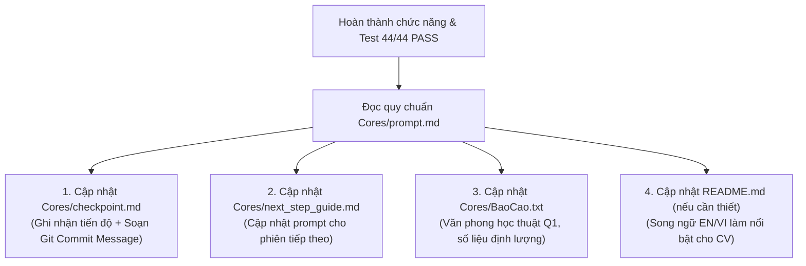

# Quy Trình Quản Lý Vòng Đời Phiên Làm Việc (CT449 Session Lifecycle)

Tài liệu này quy định kỷ luật làm việc xuyên suốt giữa Lập trình viên và các AI coding agents (**Codex**, **Gemini**, **Claude**) trong toàn bộ dự án CT449.

---

## 1. PHA KHỞI ĐẦU PHIÊN (SESSION INITIALIZATION / PRE-FLIGHT)

**Bắt buộc thực hiện ở đầu mỗi phiên làm việc mới trước khi bắt tay vào phân tích hoặc viết mã:**

Agent phải tự động đọc và đối chiếu 2 tệp ngữ cảnh cốt lõi:
1. 👉 [Cores/checkpoint.md](file:///d:/Project/CT449/Project/Cores/checkpoint.md):
   - Đọc mục `> Điểm bắt đầu cho phiên kế tiếp:` ở đầu tệp để nắm chính xác trạng thái hiện thời của hệ thống.
   - Nắm rõ danh sách các lỗi đã gặp trong quá khứ để không lặp lại sai lầm kiến trúc (ví dụ: thứ tự route trong `app.js`, định danh thông báo Deterministic ID, quy tắc Schema Yup nullable).
2. 👉 [Cores/next_step_guide.md](file:///d:/Project/CT449/Project/Cores/next_step_guide.md):
   - Nắm bắt mục tiêu và các hành động ưu tiên tiếp theo cần thực thi.
   - Nắm các quy định nghiệp vụ cốt lõi không được phép vi phạm.

---

## 2. PHA THỰC THI CHỨC NĂNG (SURGICAL EXECUTION)

1. Áp dụng nguyên tắc **Karpathy Guidelines** (Suy nghĩ trước khi code, giải pháp tối giản, phẫu thuật chính xác).
2. Tôn trọng ranh giới kiến trúc: MongoDB Native Driver (cấm Mongoose), Redis Cache Sync, 2 SPA Vue 3 độc lập (`user-web` :5173 và `admin-web` :5174).
3. Luôn chạy kiểm thử xác minh `node tests/run-api-tests.js` đạt **44/44 PASS (100%)** trước khi kết luận hoàn thành.

---

## 3. PHA KẾT THÚC CHỨC NĂNG (POST-FEATURE PROTOCOL - PROMPT.MD)

Ngay sau khi một chức năng, bug fix, hoặc module mới được hoàn thành và kiểm thử xác minh thành công, Agent **BẮT BUỘC** tự động áp dụng quy chuẩn tại 👉 [Cores/prompt.md](file:///d:/Project/CT449/Project/Cores/prompt.md):



### Chi tiết hành động cụ thể:

1. **[Cores/checkpoint.md](file:///d:/Project/CT449/Project/Cores/checkpoint.md) (RẤT QUAN TRỌNG):**
   - **Tuyệt đối KHÔNG xóa hay tạo mới**, chỉ sửa, cập nhật và bổ sung nội dung mới nhất vào đầu mục tiến độ.
   - Luôn đính kèm **Thông điệp Commit Git chuẩn mực (Conventional Commits)** ví dụ:
     ```text
     feat(loan): add atomic stock decrement on admin approval
     fix(auth): correct token validation route precedence in app.js
     ```
2. **[Cores/next_step_guide.md](file:///d:/Project/CT449/Project/Cores/next_step_guide.md) (QUAN TRỌNG):**
   - Cập nhật mục `[TRẠNG THÁI DỰ ÁN]` và `[HÀNH ĐỘNG TIẾP THEO]`.
   - Làm mới khối `PROMPT DÀNH CHO AI` để sẵn sàng copy cho phiên làm việc kế tiếp.
3. **[Cores/BaoCao.txt](file:///d:/Project/CT449/Project/Cores/BaoCao.txt) (BÁO CÁO HỌC THUẬT THỰC TẾ):**
   - Viết đầy đủ, mạch lạc vào chương tương ứng.
   - Bắt buộc tuân thủ văn phong học thuật Q1 (Khách quan, định lượng, bằng chứng thực nghiệm, zero self-praise).
4. **[Cores/Chienluoc.md](file:///d:/Project/CT449/Project/Cores/Chienluoc.md):**
   - Cập nhật nếu có bổ sung trường dữ liệu mới hoặc thay đổi chiến lược CSDL/Indexes.
5. **[README.md](file:///d:/Project/CT449/Project/README.md):**
   - Cập nhật cấu trúc song ngữ (Tiếng Anh trước, Tiếng Việt sau) khi có điểm sáng kỹ thuật đắt giá để đưa vào CV/Portfolio xin việc.

