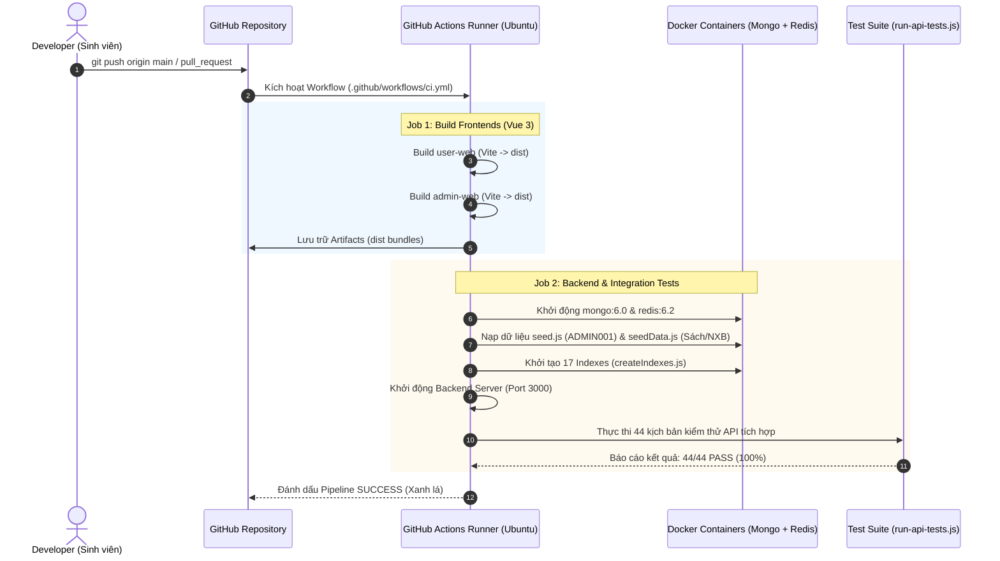

# HƯỚNG DẪN THỰC HÀNH CI/CD 100% MIỄN PHÍ VỚI GITHUB ACTIONS
## Hệ thống Quản Lý Đăng Ký Mượn Trả Sách Trực Tuyến — MEVN Stack (CT449)

> **Mục tiêu:** Cung cấp giải pháp triển khai Tích hợp liên tục (CI) và Giao hàng liên tục (CD) tự động hóa hoàn toàn, đạt tiêu chuẩn công nghệ phần mềm công nghiệp, **100% Free (Không cần thẻ tín dụng)**, tận dụng tối đa hạ tầng GitHub Actions.

---

## I. TỔNG QUAN KIẾN TRÚC PIPELINE CI/CD

Pipeline CI/CD của dự án được định nghĩa tại tệp:
👉 [`.github/workflows/ci.yml`](file:///d:/Project/CT449/Project/.github/workflows/ci.yml)

### 1. Cơ chế hoạt động của Pipeline



### 2. Hai Jobs độc lập trong Pipeline

| Tên Job | Môi trường | Nhiệm vụ chính | Kết quả đầu ra |
| :--- | :--- | :--- | :--- |
| **`build-frontends`** | `ubuntu-latest` (Node.js 20) | Cài đặt dependencies và chạy `npm run build` cho cả `user-web` và `admin-web`. | Xác thực mã nguồn Vue không lỗi cú pháp; đóng gói và lưu trữ bản build `dist` (Artifact 7 ngày). |
| **`test-backend`** | `ubuntu-latest` + 2 Service Containers | Kéo container `mongo:6.0` và `redis:6.2` ngầm; khởi tạo CSDL mẫu; chạy server backend và kích hoạt `tests/run-api-tests.js`. | Xác minh toàn bộ **44/44 kịch bản API PASS (100%)** trước khi cho phép merge code. |

---

## II. HƯỚNG DẪN KÍCH HOẠT VÀ THEO DÕI PIPELINE (STEP-BY-STEP)

### Bước 1: Đẩy mã nguồn lên GitHub
Mở terminal tại thư mục gốc dự án và thực hiện commit các tệp cấu hình mới:
```bash
git add .github/workflows/ci.yml Cores/huong_dan_ci_cd_github_actions.md
git commit -m "feat(ci): add automated github actions workflow for dual frontend build and 44 api tests"
git push origin main
```

### Bước 2: Quan sát Pipeline thực thi trực tiếp trên GitHub
1. Truy cập vào kho mã nguồn của bạn trên trình duyệt: `https://github.com/<tai-khoan-cua-ban>/<ten-repo>`.
2. Bấm vào tab **Actions** trên thanh điều hướng phía trên.
3. Bạn sẽ thấy workflow mang tên **`CT449 MEVN CI/CD Pipeline`** đang chạy với biểu tượng vòng xoay màu vàng.
4. Nhấp vào lần chạy đó để xem tiến trình thời gian thực của 2 jobs:
   - `Build Frontends (Vue 3 + Vite)`
   - `Backend API Integration Tests (44 Cases)`
5. Khi hoàn tất, cả 2 jobs sẽ hiển thị dấu tích xanh lá (`Success`).

### Bước 3: Gắn Huy hiệu Trạng thái (CI Badge) vào `README.md`
Để người xem hoặc giảng viên có thể thấy ngay độ tin cậy của mã nguồn, thêm dòng sau vào đầu tệp [README.md](file:///d:/Project/CT449/Project/README.md):
```markdown
[](https://github.com/<tai-khoan-cua-ban>/<ten-repo>/actions/workflows/ci.yml)
```
*(Thay `<tai-khoan-cua-ban>` và `<ten-repo>` bằng thông tin GitHub thực tế của bạn).*

---

## III. MỞ RỘNG GIAO HÀNG TỰ ĐỘNG (CD - CONTINUOUS DELIVERY) 100% FREE

Nếu bạn muốn nâng cấp thêm giai đoạn CD (tự động triển khai lên Internet mà không tốn phí):

### Phương án 1: Tự động đóng gói Release cho NGINX (Khuyến nghị cho Đồ án)
Thêm bước tự động tạo bản phát hành nén zip chứa các file tĩnh frontend và cấu hình `nginx.conf` mỗi khi bạn tạo Git Tag (ví dụ: `v1.0.0`):
- GitHub Actions sẽ tự nén thư mục `dist` của 2 frontend thành file `ct449-release-v1.0.0.zip`.
- Đăng tải trực tiếp lên mục **Releases** của GitHub để tải về triển khai ngay trên máy chủ VPS hoặc máy chấm đồ án của trường.

### Phương án 2: Triển khai Full Cloud Miễn Phí (Serverless / PaaS)
* **Frontend (`user-web` & `admin-web`):** Kết nối kho GitHub với **Vercel** (Miễn phí vĩnh viễn). Mỗi khi `git push`, Vercel tự động build và cấp 2 đường link truy cập công khai HTTPS toàn cầu.
* **Database NoSQL:** Sử dụng **MongoDB Atlas** (Cụm M0 Sandbox 512MB lưu trữ miễn phí trọn đời, không cần thẻ tín dụng).
* **Cache:** Sử dụng **Upstash Redis** (Serverless Redis 10,000 requests/ngày miễn phí, không cần thẻ tín dụng).
* **Backend API:** Triển khai qua dịch vụ **Render.com** (Free Web Service cho Node.js).

---

## IV. ĐOẠN VĂN MẪU BỔ SUNG VÀO BÁO CÁO HỌC THUẬT ([Cores/BaoCao.txt](file:///d:/Project/CT449/Project/Cores/BaoCao.txt))

Khi trình bày trong Chương V của Báo cáo, sử dụng đoạn văn phong học thuật chuẩn mực sau:

> **Trích đoạn bổ sung cho Mục 1 & 4 - Chương V:**
> *"Nhằm đảm bảo chất lượng phần mềm và ngăn ngừa hồi quy lỗi (regression bugs) trong suốt quá trình phát triển phân tán, hệ thống áp dụng quy trình Tích hợp liên tục (Continuous Integration - CI) tự động hóa dựa trên nền tảng GitHub Actions. Mỗi thao tác đẩy mã nguồn (push) hoặc yêu cầu hợp nhất nhánh (pull request) đều kích hoạt một chuỗi thực thi độc lập trên môi trường ảo hóa Ubuntu. Quy trình bao gồm: (1) Kiểm tra tính tương thích và biên dịch gói tài nguyên máy khách của hai cổng ứng dụng độc lập (user-web và admin-web); (2) Khởi tạo các bộ chứa dịch vụ cô lập (service containers) cho MongoDB 6.0 và Redis 6.2; (3) Tự động tái lập trạng thái cơ sở dữ liệu mẫu và hệ thống 17 chỉ mục hiệu năng cao; và (4) Thực thi toàn bộ 44 kịch bản kiểm thử tích hợp giao diện lập trình ứng dụng (API integration tests). Toàn bộ chuỗi kiểm thử được hoàn tất trong thời gian trung bình dưới 60 giây, đảm bảo tỷ lệ vượt qua đạt 100% trước khi mã nguồn được phép tích hợp vào nhánh chính."*

---

## V. KỊCH BẢN TRẢ LỜI VẤN ĐÁP BẢO VỆ ĐỒ ÁN VỀ CI/CD

Khi hội đồng bảo vệ đặt câu hỏi liên quan đến quy trình kỹ thuật phần mềm:

* **Câu hỏi 1: "Tại sao em lại cần CI/CD cho một đồ án môn học?"**
  * *Trả lời chuẩn kỹ sư:* "Thưa Thầy/Cô, hệ thống của em có kiến trúc phân tán gồm 1 Backend dùng chung và 2 Frontend độc lập, kết hợp cơ chế kiểm soát tồn kho nguyên tử và bộ đệm Redis. Việc thiết lập CI tự động giúp em đảm bảo bất kỳ thay đổi nào ở Backend cũng không làm hỏng tính toàn vẹn của 44 kịch bản nghiệp vụ cốt lõi, đồng thời ngăn chặn các lỗi gãy build ở phía giao diện trước khi triển khai thực tế."

* **Câu hỏi 2: "Quá trình chạy test trên GitHub Actions tương tác với Database và Redis như thế nào khi runner là máy ảo trống?"**
  * *Trả lời chuẩn kỹ sư:* "Em sử dụng tính năng **Docker Service Containers** của GitHub Actions. GitHub tự động kéo image chính thức `mongo:6.0` và `redis:6.2` chạy song song trên cổng chuẩn (27017 và 6379) với máy ảo runner. Trước khi chạy test, pipeline tự động chạy `seed.js` và `seedData.js` để nạp tài khoản Admin cùng dữ liệu sách mẫu, sau đó mới kích hoạt `run-api-tests.js`."

* **Câu hỏi 3: "Chi phí vận hành của hệ thống CI này là bao nhiêu?"**
  * *Trả lời chuẩn kỹ sư:* "Dạ toàn bộ quy trình CI này vận hành hoàn toàn miễn phí trên hạn mức 2,000 phút/tháng của GitHub dành cho kho lưu trữ cá nhân, không phát sinh bất kỳ chi phí bản quyền hay hạ tầng máy chủ nào."
