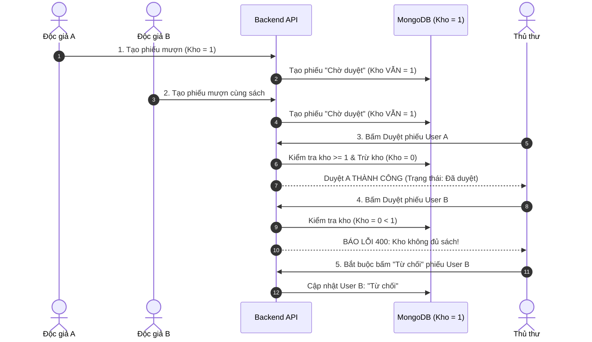

# HƯỚNG DẪN KIỂM THỬ GIAO DIỆN QUẢN TRỊ (ADMIN WEB TEST GUIDE)

> **Cổng Quản trị:** `http://localhost:5174`  
> **Đối tượng sử dụng:** Nhân viên Thư viện & Quản trị viên Hệ thống  
> **Kiến trúc:** Vue 3 (Composition API) + Bootstrap 5 + RBAC 3 cấp vai trò

---

## MỤC LỤC KỊCH BẢN KIỂM THỬ ADMIN WEB

1. [Kịch bản 1: Đăng Nhập & Phân Quyền Giao Diện Động (Dynamic Sidebar RBAC)](#kịch-bản-1-đăng-nhập--phân-quyền-giao-diện-động-dynamic-sidebar-rbac)
2. [Kịch bản 2: Quản Lý Danh Mục Sách (CRUD & Upload Ảnh)](#kịch-bản-2-quản-lý-danh-mục-sách-crud--upload-ảnh)
3. [Kịch bản 3: Quản Lý Nhà Xuất Bản (NXB CRUD & Ràng Buộc)](#kịch-bản-3-quản-lý-nhà-xuất-bản-nxb-crud--ràng-buộc)
4. [Kịch bản 4: Quản Lý Nhân Viên & Bảo Mật Hash Mật Khẩu (Admin Only)](#kịch-bản-4-quản-lý-nhân-viên--bảo-mật-hash-mật-khẩu-admin-only)
5. [Kịch bản 5: Quản Lý Độc Giả, Khóa Tài Khoản & Reset Mật Khẩu](#kịch-bản-5-quản-lý-độc-giả-khóa-tài-khoản--reset-mật-khẩu)
6. [Kịch bản 6: Duyệt Phiếu Mượn & Kịch Bản Chống Overbooking Kinh Điển](#kịch-bản-6-duyệt-phiếu-mượn--kịch-bản-chống-overbooking-kinh-điển)
7. [Kịch bản 7: Giao Sách & Xử Lý Yêu Cầu Từ Chối Mượn](#kịch-bản-7-giao-sách--xử-lý-yêu-cầu-từ-chối-mượn)
8. [Kịch bản 8: Phê Duyệt Gia Hạn Mượn Sách (+7/+14 Ngày)](#kịch-bản-8-phê-duyệt-gia-hạn-mượn-sách-714-ngày)
9. [Kịch bản 9: Xác Nhận Trả Sách & Hoàn Trả Tồn Kho Tự Động](#kịch-bản-9-xác-nhận-trả-sách--hoàn-trả-tồn-kho-tự-động)
10. [Kịch bản 10: Dashboard Thống Kê & Chứng Minh Hiệu Năng Redis Cache](#kịch-bản-10-dashboard-thống-kê--chứng-minh-hiệu-năng-redis-cache)

---

## KỊCH BẢN 1: ĐĂNG NHẬP & PHÂN QUYỀN GIAO DIỆN ĐỘNG (DYNAMIC SIDEBAR RBAC)

### Mục tiêu
Kiểm chứng cơ chế phân quyền 3 cấp vai trò (`Admin`, `NhanVienQuanLySach`, `NhanVienDuyetMuon`), đảm bảo menu Sidebar chỉ hiển thị đúng các chức năng mà nhân viên được phép truy cập.

### Bước 1: Kiểm thử Đăng nhập vai trò `Admin` (Toàn quyền)
1. Truy cập: `http://localhost:5174/login`.
2. Đăng nhập với tài khoản:
   - **MSNV:** `ADMIN001`
   - **Mật khẩu:** `Admin@123`
3. Quan sát Sidebar bên trái:
   - Hiển thị đầy đủ **6 menu chức năng**:
     1. 📊 **Dashboard Thống kê**
     2. 📚 **Quản lý Sách**
     3. 🏢 **Quản lý Nhà Xuất Bản**
     4. 📋 **Quản lý Mượn Sách**
     5. 👥 **Quản lý Độc Giả**
     6. 🛡️ **Quản lý Nhân Viên**
4. Bấm "Đăng xuất".

### Bước 2: Kiểm thử Đăng nhập vai trò `NhanVienQuanLySach` (Thủ thư Sách)
1. Đăng nhập với tài khoản:
   - **MSNV:** `NV_SACH01`
   - **Mật khẩu:** `Staff@123`
   *(Nếu chưa có, dùng tài khoản Admin tạo nhanh ở menu Nhân Viên với chức vụ `NhanVienQuanLySach`)*.
2. Quan sát Sidebar:
   - Chỉ hiển thị: **Dashboard**, **Quản lý Sách**, **Quản lý Nhà Xuất Bản**.
   - **Ẩn hoàn toàn:** Menu *Quản lý Mượn Sách*, *Quản lý Độc Giả*, *Quản lý Nhân Viên*.
3. Thử gõ trực tiếp URL `/muonsach` trên thanh địa chỉ:
   - Vue Router Guard lập tức chặn lại và chuyển hướng về trang `/sach` hoặc `/dashboard`.
4. Bấm "Đăng xuất".

### Bước 3: Kiểm thử Đăng nhập vai trò `NhanVienDuyetMuon` (Thủ thư Mượn)
1. Đăng nhập với tài khoản:
   - **MSNV:** `NV_MUON01`
   - **Mật khẩu:** `Staff@123`
   *(Chức vụ: `NhanVienDuyetMuon`)*.
2. Quan sát Sidebar:
   - Chỉ hiển thị: **Dashboard**, **Quản lý Mượn Sách**.
   - **Ẩn hoàn toàn:** Menu *Quản lý Sách*, *Quản lý NXB*, *Quản lý Độc Giả*, *Quản lý Nhân Viên*.
3. Thử gõ URL `/sach` hoặc `/nhanvien`:
   - Bị chặn ngay lập tức bởi Router Guard.

---

## KỊCH BẢN 2: QUẢN LÝ DANH MỤC SÁCH (CRUD & UPLOAD ẢNH)

### Mục tiêu
Kiểm tra các thao tác Thêm, Sửa, Xóa sách, form validation VeeValidate/Yup và cơ chế upload ảnh bìa.

### Các bước thực hiện:
1. Đăng nhập với tài khoản Admin hoặc Thủ thư Quản lý Sách $\rightarrow$ Vào menu **"Quản lý Sách"** (`/sach`).
2. **Thêm Sách Mới:**
   - Bấm nút **"Thêm sách mới"** (chuyển sang `/sach/add` hoặc mở modal).
   - Nhập thông tin:
     - Tên sách: `Lập Trình Web Full-Stack với Vue 3 và Node.js`
     - Đơn giá: `180000`
     - Số quyển: `10`
     - Năm xuất bản: `2026`
     - Nhà xuất bản: Chọn *"Nhà Xuất Bản Trẻ"* trong danh sách dropdown.
     - Tác giả: `Nguyễn Minh Tuấn`
     - Thể loại: `Công nghệ thông tin`
   - Bấm nút **"Lưu thay đổi"**.
   - Quan sát Toast xanh báo thành công. Sách mới xuất hiện ngay đầu danh sách với mã sách tự động (ví dụ: `SACH005`).
3. **Cập nhật Thông tin Sách:**
   - Tại dòng cuốn sách vừa tạo, bấm nút **"Sửa"** (icon cây bút).
   - Đổi Đơn giá thành `200000`, đổi Số quyển thành `12`.
   - Bấm **"Lưu thay đổi"** $\rightarrow$ Thông tin cập nhật chính xác trên bảng dữ liệu.
4. **Xem Chi Tiết Sách & Kiểm Tra Nút Đóng Modal:**
   - Bấm vào icon **"Xem chi tiết"** (icon con mắt).
   - Modal chi tiết hiển thị đầy đủ thông tin: Ảnh bìa, Tên sách, Tác giả, Tên NXB, Đơn giá.
   - Bấm nút **X** (Góc trên phải modal) hoặc nút **"Đóng"** $\rightarrow$ Modal đóng mượt mà, backdrop được dọn dẹp sạch sẽ (không bị đơ màn hình).
5. **Xóa Sách:**
   - Bấm nút **"Xóa"** (icon thùng rác đỏ) tại một cuốn sách thử nghiệm.
   - Hộp thoại xác nhận xuất hiện $\rightarrow$ Bấm "Xóa".
   - Cuốn sách biến mất khỏi bảng dữ liệu.

---

## KỊCH BẢN 3: QUẢN LÝ NHÀ XUẤT BẢN (NXB CRUD & RÀNG BUỘC)

### Mục tiêu
Kiểm tra quản lý danh mục Nhà xuất bản và tính toàn vẹn dữ liệu khi liên kết với sách.

### Các bước thực hiện:
1. Vào menu **"Quản lý Nhà Xuất Bản"** (`/nxb`).
2. Quan sát bảng danh sách NXB hiện có (Mã NXB, Tên NXB, Địa chỉ).
3. **Thêm NXB mới:**
   - Bấm **"Thêm NXB"**.
   - Tên NXB: `Nhà Xuất Bản Đại Học Cần Thơ`
   - Địa chỉ: `Khu 2, Đường 3/2, Q. Ninh Kiều, TP. Cần Thơ`
   - Bấm "Lưu" $\rightarrow$ Thêm mới thành công, mã NXB sinh tự động.
4. **Kiểm tra ràng buộc khi xóa NXB:**
   - Thử bấm Xóa *Nhà Xuất Bản Trẻ* (NXB đang có nhiều sách trong thư viện).
   - Hệ thống hiển thị cảnh báo chặn: *"Không thể xóa Nhà xuất bản đang có sách liên kết trong hệ thống"*.
   - Đảm bảo CSDL không xuất hiện sách mồ côi (orphaned books).

---

## KỊCH BẢN 4: QUẢN LÝ NHÂN VIÊN & BẢO MẬT HASH MẬT KHẨU (ADMIN ONLY)

### Mục tiêu
Kiểm tra tính năng dành riêng cho Admin tối cao: Thêm nhân sự, phân chức vụ và bảo mật thông tin tài khoản.

### Các bước thực hiện:
1. Đăng nhập bằng `ADMIN001` $\rightarrow$ Vào menu **"Quản lý Nhân Viên"** (`/nhanvien`).
2. Bảng hiển thị danh sách toàn bộ cán bộ thư viện: Mã nhân viên, Họ tên, Chức vụ, Số điện thoại, Địa chỉ.
3. **Thêm Nhân viên mới:**
   - Bấm **"Thêm nhân viên"**.
   - Họ tên: `Lê Quốc Bảo`
   - Chức vụ: Chọn trong dropdown `NhanVienDuyetMuon` (Thủ thư duyệt mượn).
   - Số điện thoại: `0909123456`
   - Mật khẩu khởi tạo: `Staff@123`
   - Bấm **"Tạo tài khoản"** $\rightarrow$ Thành công.
4. **Kiểm tra Bảo mật (Security Audit):**
   - Mở Developer Tools (F12) $\rightarrow$ Tab Network $\rightarrow$ Xem response JSON của request `GET /api/admin/nhanvien`.
   - **Xác minh:** 100% các đối tượng nhân viên trả về **KHÔNG CÓ trường `Password`**, bảo vệ an toàn thông tin mật khẩu dù đã được mã hóa bcrypt.
5. **Chặn Admin tự xóa chính mình:**
   - Tại dòng của tài khoản `ADMIN001`, nút Xóa bị ẩn hoặc khi bấm xóa sẽ nhận thông báo: *"Bạn không thể tự xóa tài khoản của chính mình"*.

---

## KỊCH BẢN 5: QUẢN LÝ ĐỘC GIẢ, KHÓA TÀI KHOẢN & RESET MẬT KHẨU

### Mục tiêu
Kiểm tra nghiệp vụ kiểm soát độc giả và chế tài xử lý vi phạm quy chế mượn sách.

### Các bước thực hiện:
1. Vào menu **"Quản lý Độc Giả"** (`/docgia`).
2. Quan sát danh sách độc giả: Mã ĐG, Họ tên, Email, Số điện thoại, Trạng thái (Hoạt động / Bị khóa).
3. Sử dụng thanh tìm kiếm: Nhập tên hoặc email độc giả $\rightarrow$ Kết quả lọc tức thì.
4. **Thao tác Khóa Tài Khoản Vi Phạm:**
   - Chọn một tài khoản độc giả (ví dụ: `binh.nguyen@test.com`).
   - Bấm nút **"Khóa tài khoản"** (icon ổ khóa).
   - Hộp thoại xác nhận hiện ra $\rightarrow$ Chọn Đồng ý.
   - Badge trạng thái chuyển sang màu đỏ: **`Bị khóa`**.
5. **Kiểm tra Chặn Phía Độc Giả:**
   - Mở tab User Web (`localhost:5173`) $\rightarrow$ Đăng nhập với tài khoản vừa bị khóa.
   - Hệ thống báo lỗi: *"Tài khoản của bạn đã bị khóa do vi phạm quy chế thư viện"*.
   - Nếu độc giả đang đăng nhập sẵn: Mọi thao tác mượn sách mới đều bị từ chối 403.
6. **Mở Khóa Tài Khoản:**
   - Quay lại Admin Web, bấm nút **"Mở khóa"** tại độc giả đó.
   - Trạng thái quay về màu xanh: **`Hoạt động`**. Độc giả đăng nhập lại bình thường.
7. **Đặt Lại Mật Khẩu (Reset Password):**
   - Bấm nút "Đặt lại mật khẩu" $\rightarrow$ Mật khẩu của độc giả được đưa về mật khẩu mặc định của thư viện (`Library@123`).

---

## KỊCH BẢN 6: DUYỆT PHIẾU MƯỢN & KỊCH BẢN CHỐNG OVERBOOKING KINH ĐIỂN

### Mục tiêu
Kiểm chứng tính đúng đắn của logic trừ kho nguyên tử và xử lý tranh chấp tài nguyên (Concurrency / Overbooking) - **Điểm sáng kỹ thuật lớn nhất của đồ án**.

### Các bước thực hiện Kịch bản Overbooking:

1. **Chuẩn bị Dữ liệu:**
   - Đăng nhập Admin, vào Quản lý Sách $\rightarrow$ Sửa 1 cuốn sách (ví dụ: *Clean Code*) có số lượng tồn kho: **chỉ còn đúng 1 quyển** (`SoQuyenConLai = 1`).
2. **Mô phỏng 2 Độc giả cùng yêu cầu mượn:**
   - Mở cửa sổ 1 (Trình duyệt thường): Đăng nhập Độc giả A $\rightarrow$ Mượn cuốn *Clean Code* (Số lượng: 1) $\rightarrow$ Phiếu ở trạng thái `Chờ duyệt`.
   - Mở cửa sổ 2 (Trình duyệt ẩn danh): Đăng nhập Độc giả B $\rightarrow$ Cũng vào mượn cuốn *Clean Code* (Số lượng: 1) $\rightarrow$ Phiếu ở trạng thái `Chờ duyệt`.
   - **Kiểm tra kho lúc này:** Kho sách **vẫn còn nguyên 1 quyển** vì cả 2 phiếu mới chỉ ở bước "Chờ duyệt" (Chống tình trạng giữ chỗ ảo).
3. **Thủ thư Duyệt phiếu Độc giả A:**
   - Tại Admin Web `/muonsach`, tab `Chờ duyệt`, thấy 2 phiếu mượn của A và B.
   - Bấm vào phiếu của Độc giả A $\rightarrow$ Chọn **"Duyệt phiếu"**.
   - **Kết quả:** Toast xanh thông báo duyệt thành công. Phiếu của A chuyển sang `Đã duyệt`.
   - **Số lượng tồn kho trong CSDL lập tức bị trừ từ 1 về 0.**
4. **Thủ thư Bấm Duyệt phiếu Độc giả B (Thời Khắc Kiểm Thử):**
   - Thủ thư tiếp tục chọn Duyệt phiếu của Độc giả B.
   - **KẾT QUẢ KỸ THUẬT XUẤT SẮC:**
     - Backend Service kiểm tra điều kiện nguyên tử: `SoQuyenConLai (0) < soLuong (1)`.
     - Lập tức ném lỗi HTTP `400 Bad Request`: *"Số lượng sách trong kho không đủ để duyệt yêu cầu mượn này"*.
     - Giao diện Admin hiển thị Toast thông báo đỏ cảnh báo lỗi rõ ràng. Nút duyệt bị vô hiệu.
5. **Thủ thư Xử lý Hợp lý:**
   - Thủ thư chọn thao tác **"Từ chối"** phiếu mượn của B với lý do: *"Hết sách trong kho do độc giả khác đã được duyệt trước"*.
   - Hoàn tất kịch bản chứng minh hệ thống chống Overbooking tuyệt đối!

---

## KỊCH BẢN 7: GIAO SÁCH & XỬ LÝ YÊU CẦU TỪ CHỐI MƯỢN

### Mục tiêu
Kiểm tra bước chuyển tiếp trạng thái khi độc giả đến nhận sách tại quầy.

### Các bước thực hiện:
1. Tại trang `/muonsach`, lọc theo tab **"Đã duyệt"**.
2. Tìm đến phiếu mượn của độc giả đã được duyệt.
3. Khi độc giả đến quầy xuất trình thẻ thư viện:
   - Thủ thư kiểm tra thông tin $\rightarrow$ Chọn thao tác **"Giao sách"**.
4. Trạng thái phiếu chuyển từ `Đã duyệt` sang **`Đang mượn`**.
5. Cột "Ngày bắt đầu mượn" được ghi nhận chính xác thời điểm thực tế bàn giao sách.

---

## KỊCH BẢN 8: PHÊ DUYỆT GIA HẠN MƯỢN SÁCH (+7/+14 NGÀY)

### Mục tiêu
Kiểm tra quy trình xử lý yêu cầu xin gia hạn mượn sách gửi từ độc giả.

### Các bước thực hiện:
1. Độc giả gửi yêu cầu xin gia hạn +7 ngày từ User Web (như mô tả ở Kịch bản User 9).
2. Tại Admin Web `/muonsach`, chọn tab bộ lọc: **"Chờ gia hạn"**.
3. Danh sách hiển thị phiếu mượn với huy hiệu màu tím nổi bật kèm thông tin:
   - Ngày hẹn trả cũ
   - Số ngày xin thêm (+7 ngày)
   - Số lần đã gia hạn (ví dụ: 0/2 lần)
4. **Thủ thư Duyệt gia hạn:**
   - Chọn thao tác **"Duyệt gia hạn"**.
   - Hạn trả mới của phiếu mượn được tự động tăng thêm 7 ngày.
   - Trạng thái quay trở lại **`Đang mượn`**, số lần gia hạn tăng lên 1.
5. **Thử nghiệm Từ chối gia hạn:**
   - Nếu thủ thư chọn **"Từ chối gia hạn"** $\rightarrow$ Hạn trả cũ giữ nguyên, trạng thái quay lại `Đang mượn`, độc giả nhận thông báo từ chối.

---

## KỊCH BẢN 9: XÁC NHẬN TRẢ SÁCH & HOÀN TRẢ TỒN KHO TỰ ĐỘNG

### Mục tiêu
Xác nhận hoàn tất chu trình mượn trả và tự động cộng hoàn trả số lượng sách về kho lưu trữ.

### Các bước thực hiện:
1. Độc giả mang sách đến quầy thư viện để hoàn trả.
2. Thủ thư tìm kiếm phiếu mượn theo Tên độc giả hoặc Mã phiếu mượn.
3. Tại dòng phiếu mượn đang mượn, chọn thao tác: **"Xác nhận trả sách"**.
4. Hộp thoại xác nhận xuất hiện $\rightarrow$ Bấm Đồng ý.
5. **Quan sát kết quả:**
   - Trạng thái phiếu mượn chuyển thành màu xanh lá cây: **`Đã trả`**.
   - Ngày trả thực tế được ghi nhận vào hệ thống.
   - **KIỂM TRA KHO SÁCH:** Vào menu Quản lý Sách, kiểm tra cuốn sách tương ứng $\rightarrow$ **Số lượng tồn kho được tự động cộng tăng lại đúng số lượng sách vừa trả** (`SoQuyenConLai += soLuong`).

---

## KỊCH BẢN 10: DASHBOARD THỐNG KÊ & CHỨNG MINH HIỆU NĂNG REDIS CACHE

### Mục tiêu
Phô diễn Dashboard quản trị chuyên nghiệp với Chart.js và đo lường tốc độ phản hồi 1-2ms của Redis Caching.

### Bước 1: Trình diễn Dashboard Thống Kê
1. Đăng nhập Admin tối cao hoặc Thủ thư mượn $\rightarrow$ Vào menu **"Dashboard"** (`/dashboard`).
2. **Quan sát 4 thẻ KPI tổng quan:**
   - 📚 Tổng số đầu sách & tổng số bản in
   - 👥 Tổng số độc giả đang hoạt động
   - 📖 Số lượng sách đang được mượn
   - ⚠️ Số lượng phiếu mượn quá hạn cần xử lý
3. **Quan sát 3 Biểu đồ Chart.js trực quan:**
   - **Biểu đồ tròn (Doughnut Chart):** Cơ cấu trạng thái mượn trả (Tỷ lệ phần trăm giữa Đang mượn, Đã trả, Chờ duyệt, Quá hạn).
   - **Biểu đồ đường/cột (Bar/Line Chart):** Xu hướng mượn sách theo các tháng trong năm.
   - **Biểu đồ xếp hạng (Horizontal Bar):** Top 5 cuốn sách được mượn nhiều nhất thư viện.

### Bước 2: Đo lường Tốc Độ Redis Cache (Phản hồi 1 - 2ms)
1. Mở công cụ Developer Tools trên trình duyệt (**F12**).
2. Chuyển sang tab **Network** $\rightarrow$ Tích chọn lọc "Fetch/XHR".
3. **Lần tải 1 (Cache Miss):**
   - Nhấn Ctrl+F5 để tải lại dữ liệu sách.
   - Request `GET /api/user/sach` mất khoảng **30 - 50ms** do hệ thống phải truy vấn vào MongoDB và lưu kết quả vào RAM Redis.
4. **Lần tải 2 và 3 (Cache Hit):**
   - Nhấn F5 lại trang web.
   - Quan sát thời gian phản hồi của request `GET /api/user/sach`: Thời gian tụt xuống ngoạn mục chỉ còn **1ms - 2ms**!
   - Response header có cờ ghi nhận dữ liệu được phục vụ trực tiếp từ bộ đệm bộ nhớ trong Redis.
5. **Kiểm tra Cache Invalidation:**
   - Vào Quản lý Sách $\rightarrow$ Sửa đổi tên hoặc số lượng của 1 cuốn sách.
   - Backend tự động gọi `redisClient.del("cache:sach:all")`.
   - Lần tải tiếp theo dữ liệu mới nhất được làm mới ngay tức thì, đảm bảo tính nhất quán dữ liệu 100%.
